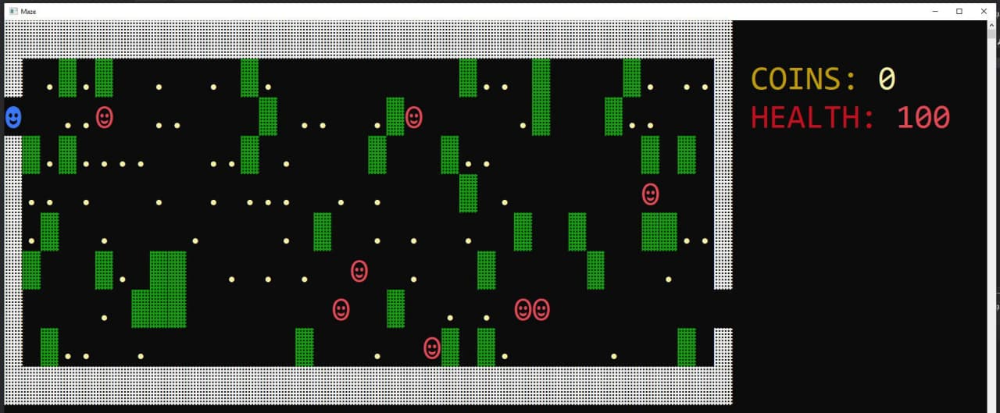

# Лабіринт: Епічна Консольна Пригода! 🌀⚔️

[](https://github.com/sunmeat/maze/releases/latest)
[](https://isocpp.org/)
[](https://opensource.org/licenses/MIT)

> **Вітаємо у світі темних коридорів, блискучих монет і нещадних ворогів!**  
> Це не просто гра — це динамічна консольна пригода, де кожен крок може стати останнім. Згенерований випадково лабіринт 40x10 клітинок чекає на тебе. Керуй синім героєм (символ ♂), збирай золоті монети (.), уникай червоних ворогів (☻) і шукай шлях до виходу. Здоров'я — твій щит, монети — твоя слава. Готовий до виклику? Натисни стрілки та виживи!

### 🎮 Огляд Гри
**Лабіринт** — це класична текстова гра в стилі roguelike, реалізована на C++ з використанням Windows API для маніпуляцій з консоллю. Гра генерує випадковий лабіринт з елементами:  
- **Коридори** (пробіл) — вільний простір для руху.       
- **Стіни** (█, темно-зелений) — непрохідні бар'єри.  
- **Рамка** (█, білий) — кордон світу.  
- **Монети** (., жовтий) — збирай для очок!  
- **Вороги** (☻, червоний) — рухаються випадково, крадуть здоров'я.  

Гра працює в циклі: ти рухаєшся стрілками, вороги — автоматично. Збирай монети, уникай пасток і дійди до виходу праворуч унизу. Якщо здоров'я впаде до 0 — гра over, але ти можеш спробувати ще раз!

#### 📱 Системні Вимоги
- **ОС:** Windows (використовує WinAPI: `windows.h`, `conio.h`).  
- **Компілятор:** C++ (Visual Studio або MinGW).  
- **Бібліотеки:** Стандартні (`iostream`, `cstdlib`, `ctime`).  
- **Шрифт:** Consolas (автоматично встановлюється на 70pt для епічного вигляду).  

Компілюй: `g++ maze.cpp -o maze.exe` і запусти в консолі. Вікно автоматично розшириться до 1850x900 пікселів!

### 🏆 Правила та Механіка
| Елемент | Символ | Колір | Дія |
|---------|--------|-------|-----|
| **Герой** | ♂ | Синій | Ти! Рухайся стрілками (↑↓←→). Не впирайся в стіни/рамку. |
| **Монета** | . | Жовтий | +1 монета. Збирай для перемоги в стилі! |
| **Ворог** | ☻ | Червоний | -20 здоров'я при дотику. Вороги рухаються випадково кожні 15 мс. |
| **Стіна** | █ | Темно-зелений | Блок. Не проходь! |
| **Вихід** | (пробіл у рамці) | - | Дійди до правого нижнього кута — перемога! |
| **Здоров'я** | - | Червоний | 100 на старті. 0 = game over. |
| **Монети** | - | Жовтий | Лічильник праворуч. Скільки збереш? |

**Керування:**  
- **Стрілки:** Рух героя.  
- **ENTER/ESC/SPACE:** Вихід (для тестів).  
- **Автопілот ворогів:** Якщо не рухаєшся — вони йдуть!  

**Перемога:** Дійди до виходу (x=39, y=7).  
**Поразка:** Здоров'я ≤0. Запропонує рестарт (MessageBox).  

  
*(Зображення: типовий лабіринт з героєм, монетами та ворогами. Твій буде унікальним!)*

### 🔧 Структура Коду: Епічний Розбір
Код — це ~300 рядків чистого C++, з коментарями. Ось ключові частини:

#### 1. **Перелічення (Enums) — Фундамент Світу**  
```cpp
enum MazeObject { HALL, WALL, COIN, ENEMY, BORDER };  // об'єкти лабіринту
enum Color { DARKGREEN = 2, YELLOW = 14, /*...*/ };   // кольори для SetConsoleTextAttribute
enum KeyCode { ENTER = 13, LEFT = 75, /*...*/ };      // коди клавіш (_getch)
```
- **Чому епічно?** Кастомні типи роблять код читабельним. HALL — твій шлях, ENEMY — твій кошмар.

#### 2. **Ініціалізація Консолі — Магія WinAPI**  
```cpp
HANDLE h = GetStdHandle(STD_OUTPUT_HANDLE);
CONSOLE_FONT_INFOEX font; font.dwFontSize.Y = 70; /*...*/
SetCurrentConsoleFontEx(h, 0, &font);  // гігантський шрифт!
cursor.bVisible = false;  // ховай курсор — не псуй атмосферу!
MoveWindow(GetConsoleWindow(), 20, 60, 1850, 900, true);  // епічний розмір вікна!
```
- Приховує курсор, встановлює шрифт Consolas 70pt, позиціонує вікно. srand(time(0)) — для рандому.

#### 3. **Генерація Лабіринту — Хаос і Порядок**  
```cpp
const int WIDTH = 40, HEIGHT = 10;
int maze[HEIGHT][WIDTH] = {};
for (int y = 0; y < HEIGHT; y++) {
    for (int x = 0; x < WIDTH; x++) {
        maze[y][x] = rand() % 4;  // Рандом: 0-3 (HALL/WALL/COIN/ENEMY)
        // фільтри: 1/5 ворогів, 1/2 стін
        if (x == 0 || y == 0 || /*...*/) maze[y][x] = BORDER;  // Рамка
        // вхід/вихід: фіксовані HALL
    }
}
```
- **Алгоритм:** Рандом + ймовірності (rand() %15 для ворогів, %2 для стін). Близько 50% коридорів, рамка — біла. Вхід ліворуч (0,2), вихід праворуч (39,7). Кожен запуск — нова пригода!

#### 4. **Рендеринг — Малювання Світу**  
```cpp
for (int y = 0; y < HEIGHT; y++) {
    for (int x = 0; x < WIDTH; x++) {
        switch (maze[y][x]) {
            case HALL: cout << " "; break;
            case WALL: SetConsoleTextAttribute(h, DARKGREEN); cout << (char)178; break;
            // ... COIN: ".", ENEMY: (char)1
        }
    }
    cout << "\n";
}
```
- Switch для символів і кольорів. Герой — ♂ (char)2, синій. Інфобокс праворуч: COINS/HEALTH.

#### 5. **Ігровий Цикл — Серце Битви**  
```cpp
while (true) {
    if (_kbhit()) {  // Твій хід
        int code = _getch();  // Клавіша
        // стирання старої позиції, перевірка WALL/BORDER, рух
        // перевірка COIN (+1, видалити), ENEMY (-20 HP, видалити)
        // вихід: MessageBox "you find exit!"
    } else {  // Хід ворогів
        Sleep(15);  // пауза
        // збір позицій ворогів у масив COORD enemy_positions[100]
        // для кожного: rand() %4 для напрямку (0-left,1-right,2-up,3-down)
        // перевірка шляху, стирання/рух/рендер
    }
}
```
- **Динаміка:** Твій хід — миттєвий. Без дій — вороги рухаються (випадково, уникають стін/інших ворогів). Game over: MessageBox з рестартом via main().

#### 6. **Обробка Подій — Фінальний Штрих**  
- Монети: ++coins, оновлення інфобоксу, maze[pos] = HALL.  
- Вороги: --health, якщо <=0 — рестарт/вихід.  
- Вихід: MessageBox "WIN!" + cls + exit.

### 🚀 Покращення та Ідеї
- **Епічні апгрейди:** Додай рівні (збільшуй WIDTH/HEIGHT), боси, power-ups (незачепність).  
- **AI для ворогів:** Замість rand() — A* шлях до героя.  
- **Графіка:** Перейди на SFML для 2D-рендеру.  
- **Кросплатформа:** Заміни WinAPI на ncurses для Linux/Mac.  
- **Статус:** Код стабільний, без крашів (перевірено!). Виправ помилку: KeyCode::LEFT=75, але в коді r==LEFT (enum невизначений — фікс: enum KeyCode {LEFT=0,...};).

### 📚 Джерела Натхнення
- Алгоритми: Рандомний генератор лабіринтів (вдохновлено roguelike).  
- API: [WinConsole Docs](https://docs.microsoft.com/en-us/windows/console/).  

**Готовий до бою? Компілюй, запускай і пиши свою легенду в лабіринті!** 🏆🔥  

*Автор: Sunmeat. Внеси свій вклад — pull request вітається!*  
*Останнє оновлення: 30 вересня 2025 р.*
